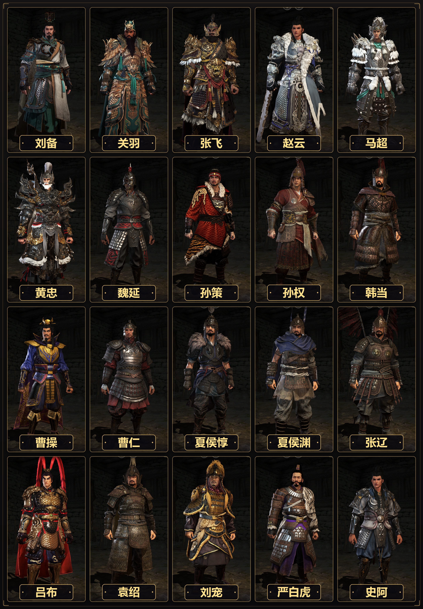
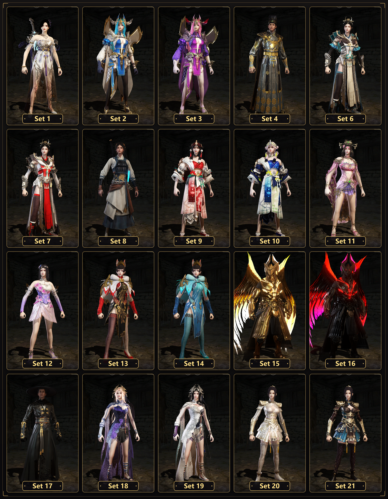
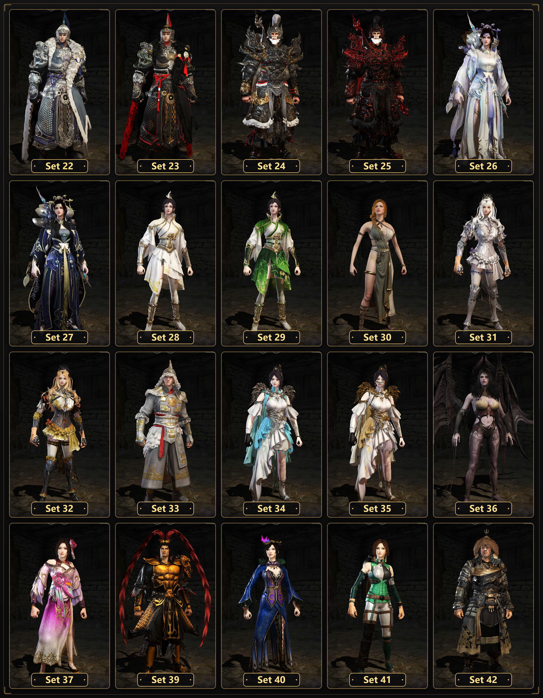
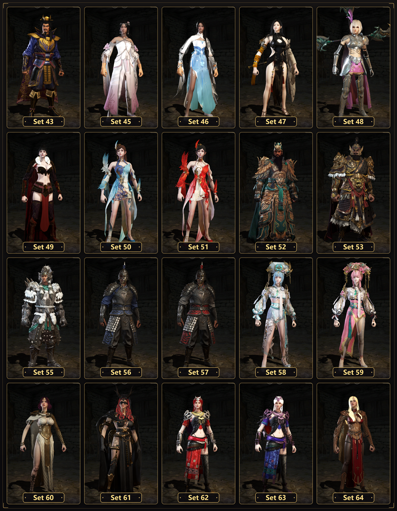
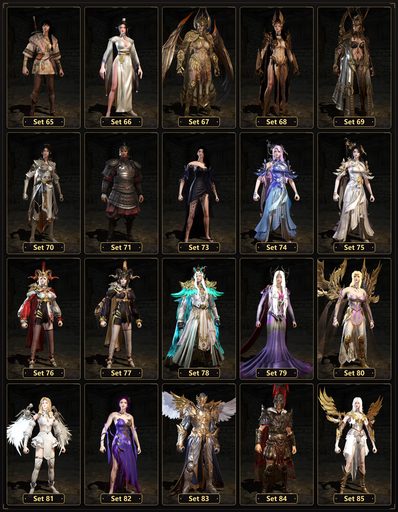
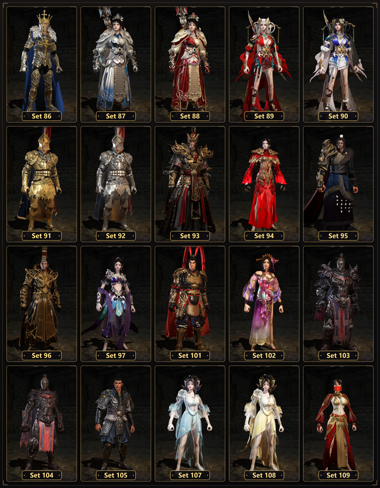

# ⚔️ Hanzo – Mount & Blade II: Bannerlord Mods Showcase

> **Official Creator Showcase & Documentation Repository by Hanzo**  
> **独立模组开发者 Hanzo 官方作品展示与文档主页（《骑马与砍杀2：霸主》）**

---

## 🔗 Official Creator Links / 官方主页与认证说明

- **爱发电官方主页 (Official Afdian Page):** [https://afdian.com/a/hanzo]
- **中文完整功能手册与新手指南 (Full CN Manual – Tencent Docs):** [点击在线查看完整手册](https://docs.qq.com/doc/DS0JqV0JQQXd4T2tw)

*(Hi Afdian team: I am **Hanzo**, independent mod developer for Mount & Blade II: Bannerlord. This repository showcases my original mod development work and officially links to my Afdian creator page above.)*  
*（爱发电审核团队您好：本人为《骑马与砍杀2：霸主》独立模组开发者 **Hanzo**，本仓库用于展示本人原创模组开发成果，上述链接为本人官方爱发电主页。）*

---

## 🛡️ Featured Project / 当前主力作品

### **YIGU THREE KINGDOMS – CUSTOM EXPANSION**
**专为《衣谷三国》打造的大型战略、RPG 玩法扩展与全面性能优化模组**  
*A large-scale strategic, RPG progression, and performance expansion built for YiGu Three Kingdoms (Bannerlord v1.2.12).*

### 📸 In-Game Screenshots / 实机展示截图

| Showcase 1 | Showcase 2 |
| :---: | :---: |
|  |  |
|  |  |
|  |  |

---

## 🔥 Core Features Overview / 核心系统一览

### 1. 大地图战略与自建王国 (Campaign Strategy & Kingdom Building)
- **自建城池开国 (Settlement Founding):** 直接在大地图白手起家建设属于自己的城池与附属村庄，提供 **7 档城池规模**（边陲城镇至繁荣帝都）。
- **军需突袭 (Supply Raids):** 突袭携带粮草的大型敌军护卫队，限时内焚毁敌军 **25% – 100%** 粮草，实现后勤断粮以弱胜强。
- **主动伏击与谨慎行军 (Ambush System):** 结合地形与昼夜机制的主动埋伏与反埋伏系统（支持 MCM 自由开关）。
- **王国领土着色与外交视图 (Territory & Diplomacy Map):** 拉远镜头自动呈现各势力领土边界与围城斜纹，按 `Alt + M` 一键切换政治与外交视图。
- **后期终局挑战与攻城辅助:** 铁血汉朝大军入侵事件（MCM 可调）与大地图自动攻城器械面板。

### 2. 高燃战场体验与细节革新 (Battlefield Mechanics & Combat Feel)
- **8 种个人战令与战后奖励轮盘:** 大型战役中随机触发限时战令，胜利后开启 5 档品质、8 大类奖励的战后轮盘。
- **战斗细节升级:** 近战横扫顺劈（Cleave）与穿刺（Pierce）、护甲与伤害公式重构、火箭（Fire Arrows）特效以及按住 `Alt` 键显示的 500 米敌我将领定位名牌。

### 3. 特色军队与外观幻化 (Unique Armies & Troop Transmog)
- **大越兵种树:** 20 种兵种、4 大特色分支（剑盾重步、反骑长枪、主力劲弩、突击骑兵）。
- **28 种专属 9 阶超级兵种:** 随 7 阶战场称号解锁，兼顾爽感与军容平衡。
- **全兵种护甲外观幻化 (Transmog):** 在百科全书中为任意兵种自由替换护甲与马甲外观，**100% 保留原有属性与战斗平衡**。

### 4. 深度 RPG 装备与 +10 / SSS 养成 (RPG Gear, +10 Enhancement & Reforging)
- **1,100+ 精选新增物品（200+ 套装与战马套装）**，分 `[C / B / A / S / SS]` 品质高亮显示，配套 **19 种套装与 +10 魂兵增益**。
- **铁匠铺 +10 强化、T1–T7 强化石合成、耐久修复、SSS 品质升华与属性词条洗炼**。
- **奇珍阁定向抽卡、静默自动拾取与全面重制的竞技场（Tournament）**。

### 5. 世界首领、传奇名将与深度扮演 (World Bosses & Roleplay)
- **两大世界首领与“以少胜多”狩猎纪录**（解锁隐藏完整套装/神兵奖励）。
- **帝王霸气与 1v1 阵前单挑招降敌将**、**5 大古今名将挑战任务链**、7 阶战场称号与约 **90 名专属套装独特同伴**。
- **双专精并行、家族伴侣扩展与日常互动、子女成长倍率自定义**与酒馆休闲小游戏。

### 6. 性能优化、崩溃修复与全维度 MCM 自定义 (Performance, Fixes & MCM)
- **预打包着色器免手动构建:** 新增 1,100+ 物品但着色器已预先打包随模组提供，进战场仅需约 **3 – 5 秒**。
- **底层崩溃修复:** 修复多项本体与衣谷原版闪退崩溃、关闭冗余日志、新增装备锁定与 9 类冗余信息过滤。
- **全维度 MCM 菜单:** 几乎所有核心玩法与数值滑块均可随时按需调整。

---

## 📋 Technical Info / 运行环境说明

| Item / 项目 | Details / 说明 |
| :--- | :--- |
| **Game Version / 支持版本** | Mount & Blade II: Bannerlord **v1.2.12** |
| **Required Mods / 前置需求** | YiGuThreeKingdoms（衣谷三国）+ Harmony, ButterLib, UIExtenderEx, MCM *(optional: Diplomacy)* |
| **Languages / 内置语言** | 简体中文 (CNs) · English (EN) · Tiếng Việt (VI) |
| **Full Manual / 完整手册** | [点击查阅完整 22 页中文指南（腾讯文档）](https://docs.qq.com/doc/DS0JqV0JQQXd4T2tw) |

---

## 🚀 Future Roadmap / 后续开发方向

In addition to maintaining and updating **YIGU THREE KINGDOMS – CUSTOM EXPANSION**, I am actively developing new standalone mods for **Mount & Blade II: Bannerlord** focusing on expanded gameplay systems, enhanced combat & visual experiences, and engine-level performance optimization.

Follow updates and support my work on Afdian: 👉 **[Hanzo's Official Afdian Page](https://afdian.com/a/hanzo)**

---

*Note: This repository is for official project showcase and documentation only. Mod packages are distributed via the official creator pages.*

